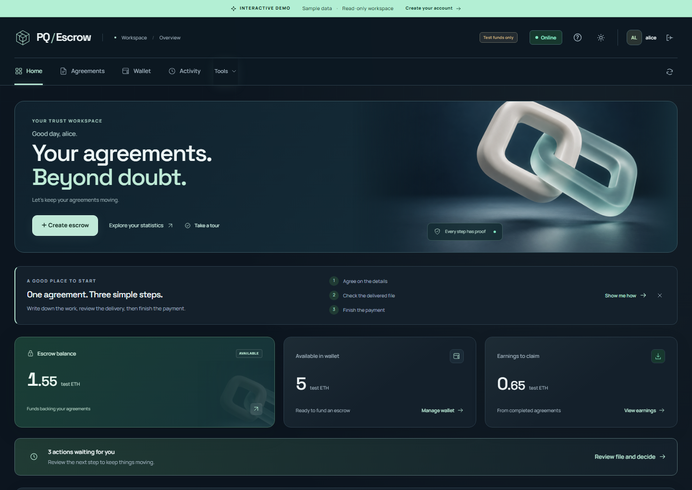
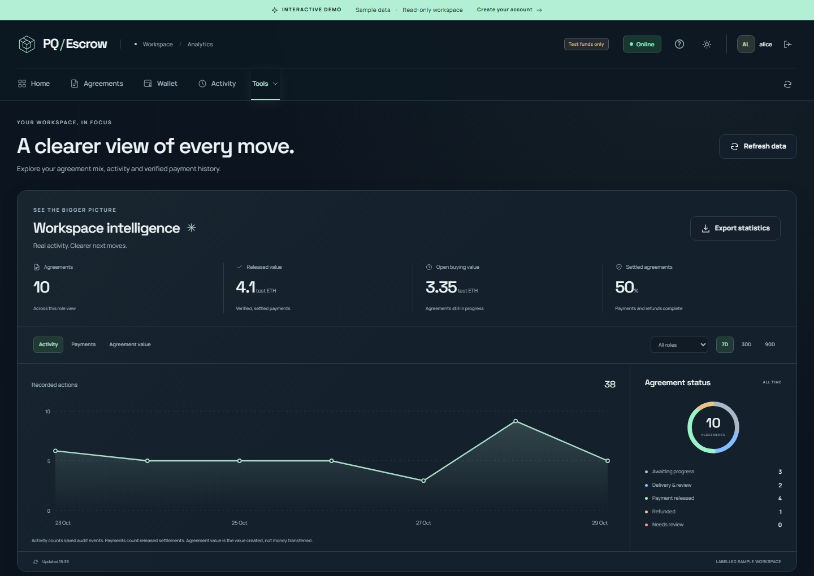
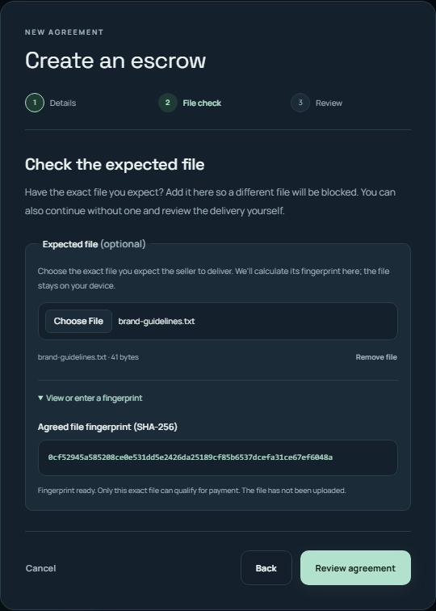

<div align="center">


# PQ-Escrow

### Clear agreements. Verified delivery.

Agree on the work, verify the exact file, and keep every signature and payment decision in one workspace.

**[Open the app](https://pq-escrow.vercel.app)** · **[Explore the interactive demo](https://pq-escrow.vercel.app/?demo=1#overview)** · **[Read the guide](docs/PROTOTYPE.md)**

Post-quantum signatures · Automatic file verification · Workspace analytics

</div>



*The current workspace, shown with clearly labelled sample data.*

## From an agreement to a verified handoff

PQ-Escrow brings the buyer and seller into a shared workflow: clear terms,
signed delivery, an explicit decision and a recorded settlement. Each agreement
keeps its evidence together, so both sides can see what happened and what comes
next.

Use the online workspace from your browser or run the local edition on your own
computer. The current release uses **simulated test ETH**; no real money moves.

| What you need | What PQ-Escrow gives you |
| --- | --- |
| Clear expectations | A guided agreement builder with a partner, amount, deadline and optional reference file. |
| The right partner | Search seller usernames, including case-insensitive @username entry, with mouse or keyboard selection. |
| The exact deliverable | Automatic SHA-256 fingerprinting. A different file is blocked when a reference fingerprint is agreed. |
| Proof at each step | ML-DSA-65 signatures on terms, delivery and decisions, with exportable evidence. |
| A clear next action | Buyer and seller views that guide each person through agreement, delivery, review and payment. |
| Updates without reloading | Incoming agreements, deliveries, decisions and payment outcomes appear automatically, with in-app notifications. |
| A way to end unfinished work | Either party can cancel before settlement, without waiting for expiry. |
| A view of your activity | Interactive charts, status breakdowns, role filters and CSV exports. |
| A workspace that stays organised | Searchable agreements, private notes, an activity inbox, profiles and session controls online. |

The inbox groups agreement cards by their current status. Each card shows the
agreement name, counterparty, creator and latest update sender, with recent history
inside the card. Filter by status, search names or usernames, or show unread
updates only. Wallet and account notifications stay in a separate section.

## See the bigger picture

Track saved activity, released payments and agreement value. Switch between
7, 30 and 90 days, filter by buying or selling role, and inspect individual
points with your pointer or keyboard. Export the selected period when you need
the numbers elsewhere.



*Charts use saved records. Open agreement value, released payments and refunds remain distinct.*

## Verify the file before the handoff

Choose a reference file while creating an agreement. PQ-Escrow calculates its
fingerprint in your browser; the reference file stays on your device. When the
seller delivers, the browser and server check the uploaded bytes against that
fingerprint. A mismatch is blocked before the delivery is saved or signed.

<p align="center">
  
</p>

A matching fingerprint confirms the exact file. The buyer still reviews whether
the work meets the agreement before approving payment. Deliveries support files
up to **25 MiB**, with chunked transfers and verified downloads.

## How it works

1. **Agree.** Choose your partner, set the terms and add a reference file if you
   have one. Both parties sign.
2. **Deliver.** The seller selects the file. PQ-Escrow checks its fingerprint and
   signs the delivery receipt.
3. **Review.** The buyer downloads the work, inspects it and signs a decision.
4. **Finish.** Connect to record the settlement. The seller can then claim the
   released test funds.
5. **Keep the proof.** Revisit the agreement, export its signed evidence or
   verify a bundle independently.

The Desktop edition supports a fully local workflow. Online, you can pause the
payment connection while signing and reviewing; the hosted workspace itself
still needs internet.

## Make it your workspace

- **Start without signing up.** The [interactive demo](https://pq-escrow.vercel.app/?demo=1#overview)
  includes sample agreements, working chart controls and a five-step product tour.
  It is read-only and separate from account data.
- **Create your account.** Register in the [live app](https://pq-escrow.vercel.app)
  for persistent agreements, uploads and the complete workflow with 10 test ETH.
  Use separate browser profiles to try the buyer and seller roles.
- **Choose your appearance.** Obsidian, Frost or System, with Mint, Ice and Violet
  accents. Your preferences stay in your browser.
- **Explore the security tools.** Verify files and signed bundles, inspect ledger
  evidence, or run five adjustable Attack lab experiments on isolated copies.

## Run locally

On Windows with Python 3.13 installed, clone the repository and launch:

```powershell
git clone https://github.com/Aravch07/Q-Escrow.git
Set-Location -LiteralPath .\Q-Escrow
.\start_web.bat
```

The launcher prepares the local environment using the included dependencies and
opens the app at **http://127.0.0.1:8766**. Keep its window open while using it.

<details>
<summary>Local sample accounts and manual setup</summary>

The seeded local accounts are `alice`, `bob` and `carol`, with password
`demo1234`. Existing changed passwords are preserved. These shared credentials
are for the local edition; create your own account on the public site.

```powershell
python -m venv .venv
& .\.venv\Scripts\python.exe -m pip install --no-index --find-links .\wheelhouse -r requirements-core.txt
& .\.venv\Scripts\python.exe -m webapp --seed-demo
```

The manual command prints its own address, normally **http://127.0.0.1:8765**.
Local accounts and hosted accounts are separate.

</details>

## Under the hood

Python powers the local server, signed protocol and verification. The hosted
edition uses Flask and Postgres for persistent accounts and evidence. The
interface uses JavaScript, self-hosted fonts and locally bundled artwork.

ML-DSA-65 authenticates signed messages; SHA-256 binds file contents. The
repository also includes a Solidity settlement contract, compiled artifact and
optional Web3 adapter. The live app currently uses a simulated settlement
ledger. Ethereum accounts themselves are not post-quantum.

Hosted signing happens on the server through encrypted sessions. This release
has not undergone an independent security audit and is not ready for real-money
custody. See the architecture and developer guide for the trust model and limits.

## Documentation

| Guide | Contents |
| --- | --- |
| [Product guide](docs/PROTOTYPE.md) | Tour, workflow, statistics and rollback instructions |
| [Live updates and cancellation](docs/LIVE-UPDATES-AND-CANCELLATION.md) | Automatic notifications, draft preservation and ending unfinished agreements |
| [Developer guide](docs/DEVELOPMENT.md) | Setup, CLI, repository layout, EVM integration and tests |
| [Hosting](docs/HOSTING.md) | Deployment, persistence, accounts and configuration |
| [Architecture](docs/ARCHITECTURE.md) | Protocol, signatures, storage and trust boundaries |
| [Web API](docs/WEBAPP.md) | Application behaviour and HTTP operations |
| [Release verification](docs/PROTOTYPE-VERIFICATION.md) | 91 passed Python checks and live browser workflow results |

The earlier release is preserved on
[`archive/pre-redesign-2026-10-29`](https://github.com/Aravch07/Q-Escrow/tree/archive/pre-redesign-2026-10-29)
for source rollback.

Wallet funds must be deposited into escrow before a payment can finish. A missing
deposit or insufficient balance now leaves an approved agreement waiting for
funding; its file and signatures remain valid for retry. See
[funding and seller search](docs/FUNDING-AND-SELLER-SEARCH.md).
